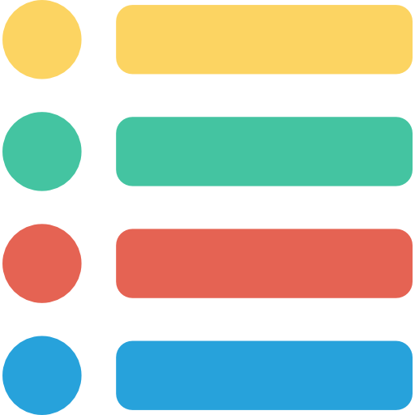
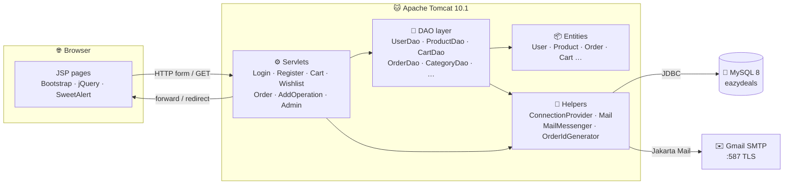
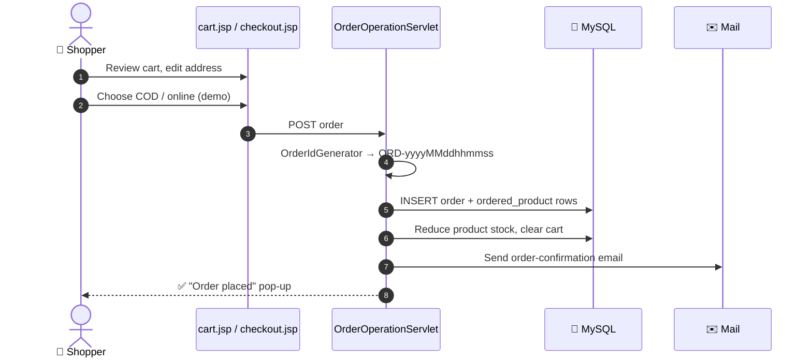
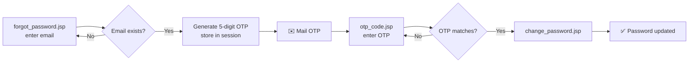
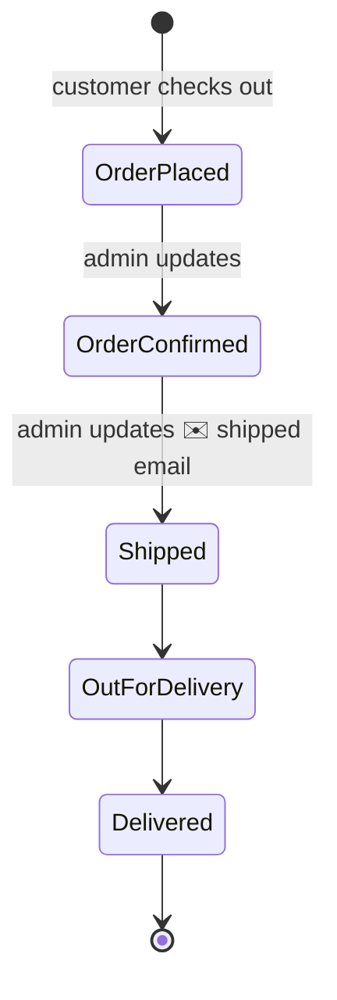
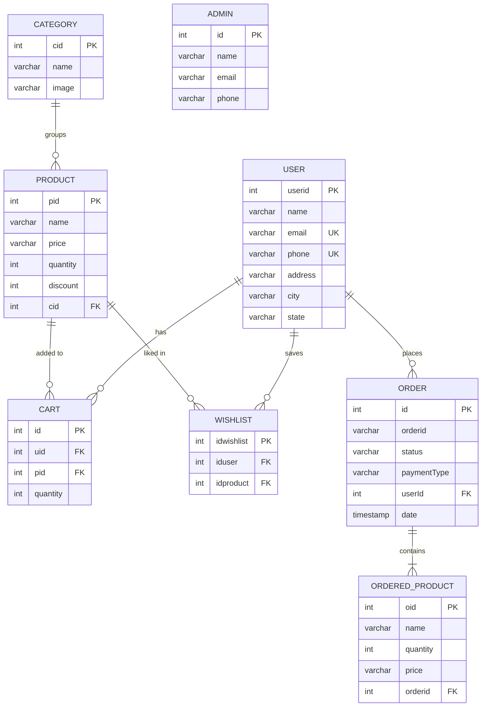

<!-- ═══════════════════════════ HEADER ═══════════════════════════ -->
<div align="center">




<a href="https://git.io/typing-svg"></a>

<!-- badges row 1 : stack -->
<p>


</p>

<!-- badges row 2 : repo -->
<p>


</p>

<!-- nav -->
<p>
<a href="#-overview"><b>📖 Overview</b></a> •
<a href="#-features"><b>✨ Features</b></a> •
<a href="#%EF%B8%8F-gallery"><b>🖼️ Gallery</b></a> •
<a href="#-architecture"><b>🏗️ Architecture</b></a> •
<a href="#-getting-started"><b>🚀 Getting Started</b></a> •
<a href="#-database"><b>🗄️ Database</b></a> •
<a href="#%EF%B8%8F-roadmap"><b>🗺️ Roadmap</b></a> •
<a href="#-developer"><b>👨‍💻 Developer</b></a>
</p>

</div>


<details>
<summary><b>📑 Table of Contents</b> (click to expand)</summary>

<br/>

1. [📖 Overview](#-overview)
2. [✨ Features](#-features)
3. [🖼️ Gallery](#%EF%B8%8F-gallery)
4. [🧰 Tech Stack](#-tech-stack)
5. [🏗️ Architecture](#-architecture)
6. [🔄 How It Works](#-how-it-works)
7. [📂 Project Structure](#-project-structure)
8. [🗄️ Database](#-database)
9. [🎨 Colour Palette](#-colour-palette)
10. [🚀 Getting Started](#-getting-started)
11. [☁️ Deployment](#%EF%B8%8F-deployment)
12. [🔐 Security Notes](#-security-notes)
13. [🗺️ Roadmap](#%EF%B8%8F-roadmap)
14. [❓ FAQ](#-faq)
15. [🤝 Contributing](#-contributing)
16. [📜 License & Credits](#-license--credits)
17. [👨‍💻 Developer](#-developer)

</details>

<!-- ═══════════════════════════ OVERVIEW ═══════════════════════════ -->
## 📖 Overview

**EazyDeals** is a full-stack **online shopping platform** built with classic Java web technologies — **JSP, Servlets and JDBC** on **Apache Tomcat 10**, backed by **MySQL 8**. Shoppers can browse, search and filter products, keep a wishlist, manage a cart and check out; administrators get a dedicated panel to run the store's catalogue, orders, users and admin team.

A built-in **mailing system** (Jakarta Mail over Gmail SMTP) emails users on registration, order confirmation, shipment and password reset (OTP).

> [!NOTE]
> The payment page is a **demo** — it is not wired to a real payment gateway, so any card details place a test order.

<div align="center">

| 🧩 Java classes | 📄 JSP pages | 🌐 Servlets | 🗃️ DB tables | ✉️ Email flows |
|:---:|:---:|:---:|:---:|:---:|
| **33** | **25** | **12** | **8** | **4** |

</div>



<!-- ═══════════════════════════ FEATURES ═══════════════════════════ -->
## ✨ Features

<table>
<tr>
<th width="33%">🛍️ Shopper</th>
<th width="33%">🛠️ Admin</th>
<th width="33%">✉️ Platform</th>
</tr>
<tr valign="top">
<td>

- 📝 Register & log in
- 🔎 Search products by keyword
- 🗂️ Filter by category
- 📦 Product detail with stock check
- ❤️ Wishlist toggle on every card
- 🛒 Cart: add, change qty, remove
- ⚡ Buy now (skip the cart)
- 🏠 Edit delivery address at checkout
- 💳 Choose COD / online (demo)
- 📜 Order history with live status
- 👤 Edit personal info

</td>
<td>

- 🔐 Separate admin login
- ➕ Add / ✏️ update / 🗑️ delete **categories** (with image)
- ➕ Add / ✏️ update / 🗑️ delete **products** (price, discount, stock, image)
- 📋 View every order & update its status
- 👥 View users & remove fraudulent accounts
- 🧑‍🤝‍🧑 Add / remove other admins
- 📊 Dashboard counters

</td>
<td>

- ✉️ Welcome email on sign-up
- 🧾 Order-confirmation email
- 🚚 "Order shipped" email
- 🔢 5-digit OTP for password reset
- 🆔 Timestamped order IDs (`ORD-yyyyMMddhhmmss`)
- 🚫 Custom 404 + exception pages
- 🍬 SweetAlert pop-ups
- 📱 Responsive Bootstrap 5 UI

</td>
</tr>
</table>

<!-- ═══════════════════════════ GALLERY ═══════════════════════════ -->
## 🖼️ Gallery

<details open>
<summary><b>🛍️ Storefront</b></summary>
<br/>

| 🏠 Home | 📝 Register | 🔐 Login |
|:---:|:---:|:---:|
|  |  |  |
| **📦 All Products** | **🗂️ Category Filter** | **🛒 Cart** |
|  |  |  |
| **💳 Checkout** | **✅ Order Placed** | **👤 Profile** |
|  |  |  |
| **❤️ Wishlist** | **🔑 Change Password** | **🔢 OTP → New Password** |
|  |  |   |

</details>

<details>
<summary><b>🛠️ Admin Panel</b></summary>
<br/>

| 📊 Dashboard | ➕ Add Category | ➕ Add Product |
|:---:|:---:|:---:|
|  |  |  |
| **🗂️ Categories** | **📦 Products** | **📋 Orders** |
|  |  |  |
| **👥 Users** | **🧑‍💼 Add Admin** | |
|  |  | |

</details>

<details>
<summary><b>✉️ Email Templates</b></summary>
<br/>

| 🎉 Registration | 🧾 Order Confirmed | 🚚 Order Shipped | 🔢 Reset OTP |
|:---:|:---:|:---:|:---:|
|  |  |  |  |

</details>

<details>
<summary><b>🎨 In-app illustrations</b> (from <code>src/main/webapp/Images</code>)</summary>
<br/>

<p align="center">




</p>
<p align="center">


</p>

</details>

<!-- ═══════════════════════════ TECH STACK ═══════════════════════════ -->
## 🧰 Tech Stack

<div align="center">


</div>

| Layer | Technology | Purpose |
|---|---|---|
| 🎨 **Frontend** | HTML5 · CSS3 · JavaScript · jQuery 3.7 · Bootstrap 5.3 · Font Awesome 6 · SweetAlert2 | Responsive UI, modals, alerts |
| 📄 **View** | JSP (Jakarta Pages) + reusable `Components/` includes | Server-rendered pages |
| ⚙️ **Controller** | Jakarta Servlets (`@MultipartConfig` for uploads) | Request handling & routing |
| 🧠 **Model / DAO** | Plain Java entities + DAO classes over **JDBC** | Data access layer |
| 🗄️ **Database** | MySQL 8.0 (InnoDB, utf8mb4) | Persistence |
| ✉️ **Mail** | Jakarta Mail 2.0.1 · Angus Activation 2.0.1 | SMTP notifications |
| 🐱 **Server** | Apache Tomcat 10.1 | Servlet container (Jakarta EE 10) |
| 🧰 **Tooling** | Eclipse IDE for Enterprise Java · MySQL Workbench | Development |

<details>
<summary><b>📦 JAR dependencies</b></summary>

| JAR | Version | Location |
|---|---|---|
| `jakarta.mail` | 2.0.1 | `WEB-INF/lib` ✅ bundled |
| `jakarta.activation-api` | 2.1.2 | `WEB-INF/lib` ✅ bundled |
| `angus-activation` | 2.0.1 | `WEB-INF/lib` ✅ bundled |
| `mysql-connector-j` | 8.0.31+ | ⬇️ **add yourself** → `WEB-INF/lib` or `$CATALINA_HOME/lib` |
| `jakarta.servlet-api` | 6.0 | provided by Tomcat 10.1 |

</details>

<!-- ═══════════════════════════ ARCHITECTURE ═══════════════════════════ -->
## 🏗️ Architecture

The app follows a classic **MVC** split — JSPs render views, Servlets act as controllers, DAOs talk to MySQL through a shared JDBC connection.



<details>
<summary><b>🧭 Servlet routing table</b></summary>

| Route | Servlet | Responsibility |
|---|---|---|
| `/RegisterServlet` | `RegisterServlet` | Create account → welcome email |
| `/LoginServlet` | `LoginServlet` | User **and** admin login (`login` param) |
| `/LogoutServlet` | `LogoutServlet` | End user / admin session |
| `/UpdateUserServlet` | `UpdateUserServlet` | Profile, address, delete user |
| `/ChangePasswordServlet` | `ChangePasswordServlet` | Forgot-password OTP + reset |
| `/AddToCartServlet` | `AddToCartServlet` | Add product to cart |
| `/CartOperationServlet` | `CartOperationServlet` | +/- quantity, remove item |
| `/WishlistServlet` | `WishlistServlet` | Add / remove wishlist item |
| `/OrderOperationServlet` | `OrderOperationServlet` | Place order (cart or buy-now) |
| `/UpdateOrderServlet` | `UpdateOrderServlet` | Admin: change order status → shipped email |
| `/AddOperationServlet` | `AddOperationServlet` | Admin CRUD for categories & products |
| `/AdminServlet` | `AdminServlet` | Admin: add / delete admins |

</details>

<!-- ═══════════════════════════ HOW IT WORKS ═══════════════════════════ -->
## 🔄 How It Works

<details>
<summary><b>🛒 Checkout & order flow</b></summary>



</details>

<details>
<summary><b>🔢 Forgot-password (OTP) flow</b></summary>



</details>

<details>
<summary><b>🛠️ Admin order lifecycle</b></summary>



</details>

<!-- ═══════════════════════════ STRUCTURE ═══════════════════════════ -->
## 📂 Project Structure

```text
📦 E-Commerce-Website
├── 📁 .github/
│   ├── 📁 ISSUE_TEMPLATE/          🐞 bug / ✨ feature templates
│   ├── 📁 workflows/build.yml      🤖 CI: compile Java + package WAR
│   └── 📄 PULL_REQUEST_TEMPLATE.md
├── 📁 database/
│   └── 🗄️ eazydeals.sql            schema + sample data (8 tables)
├── 📁 docs/
│   ├── 📁 assets/                  🎨 banner, divider, module map (SVG)
│   ├── 📄 SETUP.md                 step-by-step local setup
│   └── 📄 DATABASE.md              table reference + ER diagram
├── 📁 src/main/
│   ├── 📁 java/com/eazydeals/
│   │   ├── 📁 dao/                 🧠 8 DAO classes (JDBC)
│   │   ├── 📁 entities/            📦 9 model classes
│   │   ├── 📁 helper/              🔧 DB connection, mail, order IDs
│   │   └── 📁 servlets/            ⚙️ 12 controllers
│   └── 📁 webapp/
│       ├── 📁 Components/          🧩 navbar, alerts, CSS/JS includes
│       ├── 📁 CSS/style.css        🎨 custom styles
│       ├── 📁 JS/script.js         ⚡ client-side validation
│       ├── 📁 Images/              🖼️ UI illustrations
│       ├── 📁 Product_imgs/        📸 uploaded product & category images
│       ├── 📁 WEB-INF/             web.xml + lib/*.jar
│       └── 📄 *.jsp                25 pages (store + admin)
├── ⚙️ .project · .classpath · .settings/   Eclipse project files
├── 📄 CONTRIBUTING.md · CODE_OF_CONDUCT.md · SECURITY.md · CHANGELOG.md
└── 📘 README.md
```

<!-- ═══════════════════════════ DATABASE ═══════════════════════════ -->
## 🗄️ Database

Database name: **`eazydeals`** · dump: [`database/eazydeals.sql`](database/eazydeals.sql) · full reference: [`docs/DATABASE.md`](docs/DATABASE.md)



<!-- ═══════════════════════════ PALETTE ═══════════════════════════ -->
## 🎨 Colour Palette

| Swatch | Hex | Used for |
|:---:|:---:|---|
|  | `#2874F0` | Primary brand blue — navbar, buttons |
|  | `#389AEB` | Hover / secondary accents |
|  | `#027A3E` | Discount & "in stock" green |
|  | `#FF0303` | Wishlist heart / errors |
|  | `#E6EEFA` | Soft section backgrounds |
|  | `#909191` | Muted text, strike-through price |
|  | `#FFE500` | README / banner highlight |

<!-- ═══════════════════════════ GETTING STARTED ═══════════════════════════ -->
## 🚀 Getting Started

### ✅ Prerequisites

| Tool | Version |
|---|---|
| ☕ JDK | 17+ |
| 🐱 Apache Tomcat | 10.1.x (Jakarta EE 10) |
| 🐬 MySQL Server | 8.0+ |
| 🧰 Eclipse IDE for Enterprise Java *(or IntelliJ Ultimate)* | latest |
| 🔌 `mysql-connector-j` | 8.0.31+ |

### ⚡ Quick start

```bash
# 1️⃣ Clone
git clone https://github.com/Syed-Muhammad-Tayyab/E-Commerce-Website.git
cd E-Commerce-Website

# 2️⃣ Create & seed the database
mysql -u root -p -e "CREATE DATABASE IF NOT EXISTS eazydeals;"
mysql -u root -p eazydeals < database/eazydeals.sql
```

**3️⃣ Configure the DB connection** → `src/main/java/com/eazydeals/helper/ConnectionProvider.java`

```java
connection = DriverManager.getConnection(
        "jdbc:mysql://localhost:3306/eazydeals", "root", "root"); // ← your user / password
```

**4️⃣ Configure email (optional but recommended)** → `src/main/java/com/eazydeals/helper/Mail.java`

```java
String emailId  = "your-store@gmail.com";   // sender Gmail
String password = "xxxx xxxx xxxx xxxx";    // Google App Password (not your login password)
```

**5️⃣ Add the MySQL driver** — drop `mysql-connector-j-8.x.jar` into `src/main/webapp/WEB-INF/lib/`.

**6️⃣ Run it**

<details>
<summary><b>🌘 Eclipse (recommended)</b></summary>

1. `File → Import → Existing Projects into Workspace` → select the repo folder.
2. `Window → Preferences → Server → Runtime Environments` → add **Apache Tomcat v10.1**.
3. Right-click project → `Run As → Run on Server`.
4. Open **http://localhost:8080/E-Commerce-Website/**

</details>

<details>
<summary><b>💻 Command line (no IDE)</b></summary>

```bash
export CATALINA_HOME=/path/to/apache-tomcat-10.1.x
mkdir -p build/classes
javac --release 17 -d build/classes \
  -cp "$CATALINA_HOME/lib/servlet-api.jar:src/main/webapp/WEB-INF/lib/*" \
  $(find src/main/java -name '*.java')
mkdir -p dist && cp -r src/main/webapp dist/eazydeals
mkdir -p dist/eazydeals/WEB-INF/classes && cp -r build/classes/* dist/eazydeals/WEB-INF/classes/
(cd dist/eazydeals && jar -cf ../eazydeals.war .)
cp dist/eazydeals.war "$CATALINA_HOME/webapps/"
"$CATALINA_HOME/bin/startup.sh"
# → http://localhost:8080/eazydeals/
```

</details>

### 🔑 Demo logins (from the sample dump)

| Role | Email | Password |
|---|---|---|
| 🛠️ Admin | `test@gmail.com` | `abc123` |
| 🛍️ User | `test786@gmail.com` | `abc123` |

> [!WARNING]
> These are sample credentials shipped in the SQL dump — change or delete them before going live.

📘 Full walkthrough with troubleshooting: **[docs/SETUP.md](docs/SETUP.md)**

<!-- ═══════════════════════════ DEPLOYMENT ═══════════════════════════ -->
## ☁️ Deployment

| Option | How |
|---|---|
| 🐱 **Any Tomcat 10.1 host** | Build the WAR (above) → upload to `webapps/` |
| 🤖 **GitHub Actions artifact** | Every push runs [`build.yml`](.github/workflows/build.yml) → download `eazydeals-war` from the run |
| ☁️ **Railway / Render / VPS** | Run Tomcat 10.1 + a managed MySQL 8; point `ConnectionProvider` at the cloud DB |

> [!IMPORTANT]
> Static hosts like **Vercel, Netlify or GitHub Pages cannot run this project** — JSP/Servlets need a Java servlet container.

<!-- ═══════════════════════════ SECURITY ═══════════════════════════ -->
## 🔐 Security Notes

This is a learning-grade project. Before any real deployment, review **[SECURITY.md](SECURITY.md)** — key items:

- 🔑 Passwords are stored in **plain text** → hash with BCrypt/Argon2.
- 🧾 DB & SMTP credentials are **hard-coded** → move to environment variables / `context.xml`.
- 🛡️ No CSRF tokens on forms; add them for state-changing requests.
- 💳 Payment is a **mock** — integrate a real gateway (Stripe, JazzCash, Easypaisa…) server-side.

<!-- ═══════════════════════════ ROADMAP ═══════════════════════════ -->
## 🗺️ Roadmap

- [x] User registration, login, profile
- [x] Category & product catalogue with search
- [x] Cart, wishlist, buy-now, checkout
- [x] Admin panel (categories, products, orders, users, admins)
- [x] Email notifications + OTP reset
- [x] Repo redesign: docs, CI, templates, cleaned `web.xml`
- [ ] 🔐 Password hashing (BCrypt)
- [ ] ⚙️ Externalised config (env vars)
- [ ] 📦 Maven `pom.xml` build
- [ ] 💳 Real payment gateway
- [ ] ⭐ Product reviews & ratings
- [ ] 🐳 Docker Compose (Tomcat + MySQL)
- [ ] 🌙 Dark mode

<!-- ═══════════════════════════ FAQ ═══════════════════════════ -->
## ❓ FAQ

<details>
<summary><b>Product images don't show after importing the SQL dump?</b></summary>

The dump references images like `phone1.jpeg`, but the image files themselves are not in the repo. Images live in `src/main/webapp/Product_imgs/` — upload products again from the admin panel, or copy your own files with matching names into that folder.

</details>

<details>
<summary><b><code>ClassNotFoundException: com.mysql.cj.jdbc.Driver</code></b></summary>

The MySQL connector JAR is missing. Put `mysql-connector-j-8.x.jar` in `src/main/webapp/WEB-INF/lib/` (or Tomcat's `lib/`) and redeploy.

</details>

<details>
<summary><b>Emails aren't being sent.</b></summary>

Fill in `emailId` and `password` in `Mail.java`. For Gmail, enable 2-Step Verification and create an **App Password** — your normal Gmail password won't work.

</details>

<details>
<summary><b>Can I run it on Tomcat 9?</b></summary>

No. The code uses the `jakarta.*` namespace (Jakarta EE 9+), so it needs **Tomcat 10 or newer**. Tomcat 9 expects `javax.*`.

</details>

<details>
<summary><b>Where is the admin login?</b></summary>

Open `adminlogin.jsp` (linked from the navbar) and use an account from the `admin` table.

</details>

<!-- ═══════════════════════════ CONTRIBUTING ═══════════════════════════ -->
## 🤝 Contributing

Contributions are welcome! Please read **[CONTRIBUTING.md](CONTRIBUTING.md)** and our **[Code of Conduct](CODE_OF_CONDUCT.md)**.

```bash
git checkout -b feature/amazing-feature
git commit -m "feat: add amazing feature"
git push origin feature/amazing-feature   # → open a Pull Request
```

<!-- ═══════════════════════════ LICENSE ═══════════════════════════ -->
## 📜 License & Credits

- 🧑‍💻 **Original application:** EazyDeals by [Anirudh Kumar Bhagat (@bhagatanirudh)](https://github.com/bhagatanirudh) — screenshots in the gallery are from the original project.
- 🎨 **Repository redesign, documentation, CI & tooling:** [Syed Muhammad Tayyab](https://github.com/Syed-Muhammad-Tayyab).
- 📄 The upstream project does not declare a license. Respect the original author's rights; add a `LICENSE` file only if you own the code or have permission.
- 🙏 Thanks to Bootstrap, Font Awesome, SweetAlert2, jQuery, capsule-render, readme-typing-svg, shields.io and skillicons.dev.

<!-- ═══════════════════════════ DEVELOPER ═══════════════════════════ -->
## 👨‍💻 Developer

<div align="center">


<a href="https://github.com/Syed-Muhammad-Tayyab"></a>


<br/><br/>

**⭐ If this project helped you, drop a star — it keeps the repo alive!**

</div>

<!-- ═══════════════════════════ FOOTER ═══════════════════════════ -->

