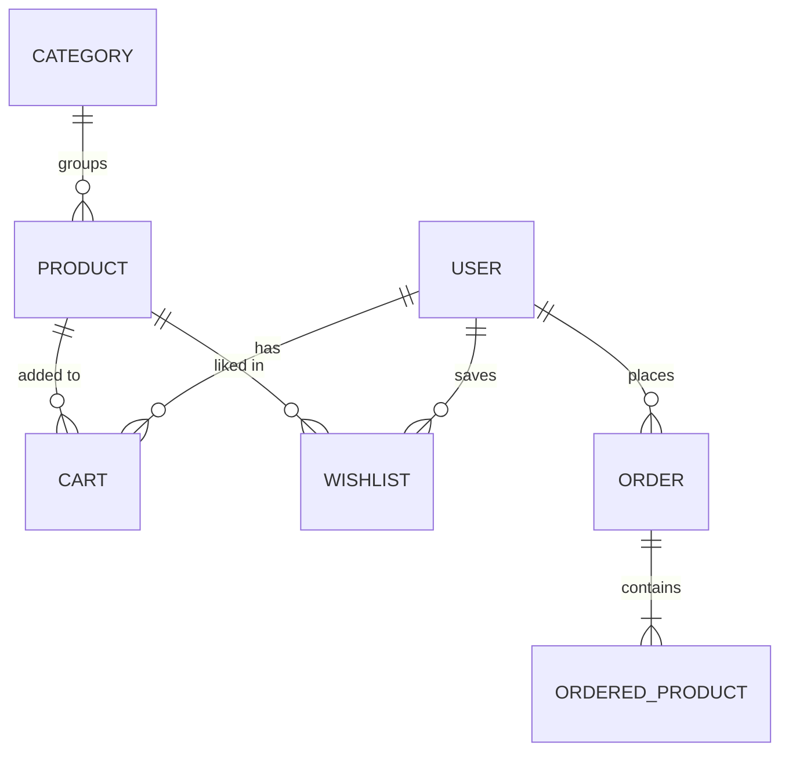

# 🗄️ EazyDeals — Database Reference

**Developed by Syed Muhammad Tayyab**

Schema: **`eazydeals`** · Engine: InnoDB · Charset: `utf8mb4` · Dump: [`../database/eazydeals.sql`](../database/eazydeals.sql)

## 👤 `user`
| Column | Type | Notes |
|---|---|---|
| `userid` | INT PK AI | |
| `name` | VARCHAR(100) | |
| `email` | VARCHAR(45) | UNIQUE |
| `password` | VARCHAR(45) | ⚠️ plain text |
| `phone` | VARCHAR(20) | UNIQUE |
| `gender` | VARCHAR(20) | |
| `registerdate` | TIMESTAMP | default now |
| `address`, `city`, `pincode`, `state` | VARCHAR | delivery address |

## 🛠️ `admin`
| Column | Type |
|---|---|
| `id` | INT PK AI |
| `name`, `email`, `phone` | VARCHAR |
| `password` | VARCHAR(50) ⚠️ plain text |

## 🗂️ `category`
| Column | Type | Notes |
|---|---|---|
| `cid` | INT PK AI | |
| `name` | VARCHAR(100) | |
| `image` | VARCHAR(100) | file in `Product_imgs/` |

## 📦 `product`
| Column | Type | Notes |
|---|---|---|
| `pid` | INT PK AI | |
| `name` | VARCHAR(250) | |
| `description` | VARCHAR(500) | |
| `price` | VARCHAR(20) | MRP |
| `quantity` | INT | stock |
| `discount` | INT | percent |
| `image` | VARCHAR(100) | file in `Product_imgs/` |
| `cid` | INT FK → `category.cid` | |

## 🛒 `cart`
| Column | Type |
|---|---|
| `id` | INT PK AI |
| `uid` | INT FK → `user.userid` |
| `pid` | INT FK → `product.pid` |
| `quantity` | INT |

## ❤️ `wishlist`
| Column | Type |
|---|---|
| `idwishlist` | INT PK AI |
| `iduser` | INT FK → `user.userid` |
| `idproduct` | INT FK → `product.pid` |

## 🧾 `order`
| Column | Type | Notes |
|---|---|---|
| `id` | INT PK AI | |
| `orderid` | VARCHAR(100) | `ORD-yyyyMMddhhmmss` |
| `status` | VARCHAR(100) | Order Placed → Order Confirmed → Shipped → Out For Delivery → Delivered |
| `paymentType` | VARCHAR(100) | `COD` / `online` |
| `userId` | INT FK → `user.userid` | |
| `date` | TIMESTAMP | default now |

## 📋 `ordered_product`
| Column | Type | Notes |
|---|---|---|
| `oid` | INT PK AI | |
| `name` | VARCHAR(100) | snapshot of product name |
| `quantity` | INT | |
| `price` | VARCHAR(45) | price paid |
| `image` | VARCHAR(100) | |
| `orderid` | INT FK → `order.id` | |

> `order` is a reserved word in SQL — always quote it with backticks: `` SELECT * FROM `order`; ``
